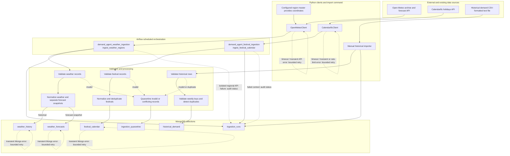

# Demand Agent Data Ingestion

Initial implementation of the Demand Agent for the Kolkata Multi-Agent Supply
Chain Management System. The current development scope collects, validates,
normalizes, and stores the weather, festival, and historical-demand data needed
by the future demand forecasting system. The ingestion pipelines are designed
for 40 configured geographical regions in Kolkata.

This README describes the implementation currently present in this repository.
It does not imply that external APIs, a live MongoDB deployment, or Airflow
scheduling have been integration-tested.

## Two independent ingestion paths

- **External API path:** Open-Meteo weather and Calendarific festivals use
  their respective Python clients and scheduled Airflow DAGs, then pass through
  validation/normalization and MongoDB persistence.
- **Historical demand path:** the supplied dataset is loaded independently by
  a manual utility into MongoDB's `historical_demand` collection. It is not an
  API adapter, is not a task in either DAG, and has no periodic schedule.

## Implemented data sources

### Open-Meteo weather

The Python adapter retrieves daily historical observations and upcoming daily
forecasts from Open-Meteo. Historical requests accept a date range. Forecasts
default to seven days and support a configurable horizon of up to 16 days.
Weather request dates use the configured timezone, `Asia/Kolkata` by default.

The normalized weather schema supports mean/minimum/maximum temperature,
relative humidity, precipitation, rainfall, WMO weather code, wind speed, and
coverage. Missing individual measurements are retained as `None`; records with
no weather measurements are rejected. The ingestion pipeline obtains
coordinates from the configured region master rather than embedding them in
API code.

The weather ingestion requires a valid region master with exactly 40 regions.
No authoritative coordinate-bearing master is currently included in this
repository, so live regional collection requires that input to be supplied.

### Calendarific festivals and holidays

The adapter retrieves Indian (`IN`) holidays by year and requests national and
West Bengal (`IN-WB`) contexts separately where supported. It preserves event
names, dates, optional descriptions and categories, location/state information,
and the original provider data. Missing optional fields are not invented.
Calendarific authentication uses `CALENDARIFIC_API_KEY` from the environment.
Invalid-key and other provider errors are reported without exposing the key;
network failures and rate limits receive bounded retries.

## Independent historical-demand dataset and loader

The existing comma-separated text dataset is discoverable and profiled without
changing it. The import workflow maps product-region weekly records into a
validated storage schema. The expected import columns are:

| Column | Meaning |
|---|---|
| `region_id` | Configured region identifier |
| `product_id` | Product identifier |
| `week_start_date` | Inclusive week start date |
| `week_end_date` | Inclusive week end date |
| `units_sold` | Non-negative integer weekly demand |

The dataset profile found 1,112,000 rows, 40 regions, 200 products, and
seven-day intervals spanning 2024-01-01 through 2026-08-29. These are dataset
inspection results, not evidence that the file has been imported into MongoDB.
The source file remains unchanged. Its region IDs do not include geographic
coordinates.

## Python adapters and configuration

The importable package uses a `src/` layout under `demand_agent_ingestion`.
Reusable clients return Pydantic-validated records. The `*_result` methods
return a structured result containing records and a separate source-metadata
object; compatibility methods that return record lists are also available.

| File | Responsibility |
|---|---|
| `src/demand_ingestion/open_meteo_client.py` | Open-Meteo archive and forecast requests, input/response validation, bounded HTTP retries, timeout handling, and source errors. |
| `src/demand_ingestion/weather_models.py` | Validated daily weather response records. |
| `src/demand_ingestion/calendarific_client.py` | Calendarific request/authentication, API response validation, duplicate handling, rate-limit/network retry, and redacted errors. |
| `src/demand_ingestion/festival_models.py` | Structured festival records including preserved provider data. |
| `src/demand_ingestion/source_metadata.py` | `SourceResult` and metadata contracts for source, retrieval time, requested range/year, region, request/response status, data availability, and errors. |
| `src/demand_ingestion/config.py` | Environment-backed settings, defaults, validation, and production configuration checks. |
| `src/demand_ingestion/data_sources/region_master.py` | CSV region and coordinate loading; rejects missing, duplicate, or invalid coordinates. |
| `src/demand_ingestion/historical_demand/dataset_discovery.py` | Independent historical file discovery, header, delimiter, and format identification. |
| `src/demand_ingestion/historical_demand/schema_profile.py` | Read-only row, column, region/product coverage, date, weekly interval, and demand checks; separate from external API sources. |

HTTP requests use a configurable timeout and bounded retries with exponential
backoff. Failed API calls carry source metadata; logs and raised Calendarific
errors redact credentials. Weather records use nullable optional measurements.
The source adapters do not directly persist data: the ingestion pipelines
validate, normalize, quarantine, and write records.

Configuration is defined in `src/demand_ingestion/config.py`. The root
[`.env.example`](.env.example) lists the available environment variables. Copy
it to a local `.env`, set deployment-specific values, and do not commit secrets.
Settings are read from environment variables and a `.env` file relative to the
process working directory. Paths are likewise resolved relative to the working
directory unless absolute paths are provided.

Important settings include:

| Variable | Default | Purpose |
|---|---|---|
| `OPEN_METEO_BASE_URL` | Open-Meteo forecast endpoint | Forecast API endpoint |
| `OPEN_METEO_ARCHIVE_URL` | Open-Meteo archive endpoint | Historical API endpoint |
| `CALENDARIFIC_BASE_URL` | Calendarific holidays endpoint | Holiday API endpoint |
| `CALENDARIFIC_API_KEY` | unset | Required Calendarific credential |
| `DEFAULT_TIMEZONE` | `Asia/Kolkata` | Weather date and forecast timezone |
| `DEFAULT_COUNTRY` / `DEFAULT_REGION_CODE` | `IN` / `IN-WB` | Festival request context |
| `DEFAULT_FORECAST_DAYS` | `7` | Forecast horizon (1–16 days) |
| `REGION_MASTER_DATASET_PATH` | `region_master.csv` | Region coordinates CSV |
| `HTTP_TIMEOUT_SECONDS` | `20` | External request timeout |
| `HTTP_MAX_RETRIES` | `3` | Retries after the initial request |
| `HTTP_BACKOFF_MAX_SECONDS` | `30` | Maximum configured retry backoff |
| `MONGO_URI` / `MONGO_DATABASE` | local MongoDB / `demand_agent` | Mongo connection and database |
| `MONGO_USERNAME`, `MONGO_PASSWORD`, `MONGO_AUTH_SOURCE` | unset / unset / `demand_agent` | Optional Mongo authentication |

Additional external-ingestion settings for history lookback/backfill, festival
refresh/cache, batch size, Mongo timeouts, and DAG schedules are defined in the
same settings module and listed in `.env.example`. Historical file location is
configured separately for the manual loader. For further details on API
endpoints and Calendarific authentication, see
[`external_source_configuration.md`](demand_agent_ingestion/docs/external_source_configuration.md).

## Ingestion and Airflow DAGs

The reusable ingestion entry points are
`demand_ingestion.ingestion.weather_ingestion.ingest_weather` and
`demand_ingestion.ingestion.festival_ingestion.ingest_festivals`. Each pipeline
opens an audited run, calls its API client, validates and normalizes results,
persists invalid records to quarantine, and upserts accepted records. Weather
requests are processed per region; an API failure for one region is isolated
from requests for other regions. Festival requests are grouped by year and
national/regional context. Successful festival contexts are cached for the
configured TTL.

Airflow DAGs call those same Python pipelines through one `PythonOperator` task
each:

| DAG ID | Python file | Task ID | Default schedule | Task retries |
|---|---|---|---|---|
| `demand_agent_weather_ingestion` | `dags/weather_ingestion_dag.py` | `ingest_weather_regions` | `0 1 * * *` (daily) | 2, five minutes apart |
| `demand_agent_festival_ingestion` | `dags/festival_ingestion_dag.py` | `ingest_festival_calendar` | `0 2 1 * *` (monthly, first day) | 2, five minutes apart |

The schedules are configurable with `WEATHER_INGESTION_SCHEDULE` and
`FESTIVAL_INGESTION_SCHEDULE`. DAG start dates use the configured timezone,
`catchup` is disabled, and each DAG limits itself to one active run. Each has a
single task, so there are no additional task-to-task dependencies. A failed
pipeline run raises an Airflow task error; `PARTIAL_SUCCESS` is recorded and
returned by the task, with individual failures available in the MongoDB run
audit.

The DAG files are present, but Airflow is not a dependency in `pyproject.toml`
and DAG parsing/scheduler execution has not been verified in an Airflow
deployment. Install a Python-compatible Airflow distribution in the target
Airflow environment, install this package there, and configure Airflow to read
the repository's `demand_agent_ingestion/dags/` directory. Do not treat
mocked pipeline tests as verification of Airflow execution.

## Validation, normalization, and quarantine

- **API response contracts:** Pydantic models validate weather and festival
  response fields, dates, units/ranges, and provider structures. Malformed API
  envelopes and invalid input coordinates produce source errors.
- **Weather normalization:** Daily observations are checked against the
  configured location registry and canonical schema. Historical and forecast
  records use separate business keys; forecasts include a per-run snapshot ID.
  Current/future dates returned by the historical endpoint are quarantined.
- **Festival normalization:** Event names/dates/types and provider context are
  retained in a canonical structure. Optional descriptions and categories stay
  absent when the API omits them. Duplicate events are reconciled; invalid or
  conflicting records are quarantined.
- **Historical demand validation:** The importer verifies required headers,
  region/product identifiers when masters are configured, ISO dates,
  non-negative integer demand, seven-day date spans, and duplicate
  region-product-week keys. It reports weekly continuity gaps without creating
  missing weeks or zero-demand rows.
- **Quarantine:** Rejected records are saved separately with a sanitized
  original record, validation errors, source/run information, error category,
  fingerprint, and `PENDING` status. Guarded transitions support controlled
  processing status changes.

Missing individual weather variables are represented as `None`; a weather
record with no measurements fails validation. Missing optional festival fields
remain `None` or empty as appropriate. Rejected dataset rows are kept in
quarantine rather than mixed with accepted documents.

Normalization code is in `src/demand_ingestion/normalization/`; the
source-specific ingestion and historical import logic is in
`src/demand_ingestion/ingestion/`.

## MongoDB integration

`src/demand_ingestion/database/mongodb.py` creates the configured PyMongo
client, applies connection/socket/server-selection timeouts and retryable
writes, pings the server, and ensures indexes. Optional username/password
authentication is supported; credentials must be configured together.
Transient Mongo connectivity errors receive bounded retries.

The application uses these six collections:

| Collection | Stored document content | Unique business key |
|---|---|---|
| `weather_history` | Normalized daily observations, measurements, source, retrieval time, and record identity | `location_id`, `weather_date` |
| `weather_forecasts` | Normalized forecast observations plus snapshot/issue provenance | `location_id`, `weather_date`, `forecast_snapshot_id` |
| `festival_calendar` | Normalized event/date/category, regional applicability, provider payload, and provenance | `country_code`, `region_code`, `event_date`, `normalized_event_name` |
| `historical_demand` | Original dataset columns under `source_fields`, validated region/product/week fields, demand quantity, source reference, and source-row hash | `region_id`, `product_id`, `week_start` |
| `ingestion_runs` | Run ID, source/command, timestamps, status, record counters, errors, contexts, and source metadata | `ingestion_run_id` |
| `ingestion_quarantine` | Sanitized original record, validation errors, source/run information, fingerprint, and processing status | `quarantine_id` |

`src/demand_ingestion/database/indexes.py` defines the unique and operational
indexes. `upsert_manager.py` generates deterministic IDs from business keys,
compares content hashes, and performs unordered bulk upserts. Repeated
unchanged records are counted rather than rewritten; partial write failures
are reported. Run status is persisted separately from source records by
`monitoring/ingestion_logger.py`.

Unit tests exercise Mongo operations through an in-memory compatible fake.
No live MongoDB connection or production persistence run has been verified.

## Separate historical-demand import

Historical demand is imported separately from the scheduled weather and
festival DAGs because it is an existing bulk dataset with a dedicated
validation, duplicate-check, and resumable-import workflow. It is not scheduled
or triggered by either API DAG.

The command `scripts/import_historical_demand.py` calls
`historical_demand/importer.py`. It streams the configured comma-separated
file, maps the five required source fields to a validated weekly record,
requires non-empty region/product IDs, optionally checks them against explicit
allow-lists when supplied, and writes accepted records in batches. The
coordinate-bearing region master is not required for this data path. Duplicate
source keys and invalid rows are quarantined. A temporary SQLite key index
bounds memory usage for duplicate detection. Mongo insert-only upserts make
reruns idempotent without overwriting existing records. The complete original
CSV row is retained under `source_fields`, alongside validated query fields.
Each execution has its own audit run.

The default dataset path is relative to the process working directory. If
running from inside `demand_agent_ingestion`, set
`HISTORICAL_DEMAND_DATASET_PATH=..\agent_demand_integrated.txt` (or configure an
absolute path). The importer requires MongoDB; explicit region/product
allow-lists are optional. No full import to a live MongoDB has been performed.

## Implemented workflow



The historical importer is a manual path, not an Airflow DAG. Mongo and API
error behavior shown above is implemented in the clients/persistence code;
live retry behavior has not been confirmed against deployed services.

## Project structure

The following is the current ingestion-relevant repository structure; local
virtual environments, caches, and the large source dataset are omitted.

```text
.
├── .env.example
├── README.md
├── agent_demand_integrated.txt
├── weather_event_integrated.csv
├── demand_agent_ingestion/
│   ├── pyproject.toml
│   ├── dags/
│   │   ├── festival_ingestion_dag.py
│   │   └── weather_ingestion_dag.py
│   ├── docs/
│   │   ├── block2_secure_ingestion.md
│   │   ├── external_source_configuration.md
│   │   └── normalization_design.md
│   ├── scripts/
│   │   ├── demo_weather_model.py
│   │   ├── import_historical_demand.py
│   │   ├── test_calendarific_live.py
│   │   └── test_open_meteo_live.py
│   ├── src/demand_ingestion/
│   │   ├── calendarific_client.py
│   │   ├── config.py
│   │   ├── festival_models.py
│   │   ├── open_meteo_client.py
│   │   ├── source_metadata.py
│   │   ├── weather_models.py
│   │   ├── data_sources/
│   │   │   └── region_master.py
│   │   ├── historical_demand/
│   │   │   ├── dataset_discovery.py
│   │   │   ├── importer.py
│   │   │   ├── schema_profile.py
│   │   │   └── validation.py
│   │   ├── database/
│   │   │   ├── collections.py
│   │   │   ├── indexes.py
│   │   │   ├── mongodb.py
│   │   │   └── upsert_manager.py
│   │   ├── ingestion/
│   │   │   ├── festival_ingestion.py
│   │   │   ├── quarantine.py
│   │   │   └── weather_ingestion.py
│   │   ├── monitoring/
│   │   │   └── ingestion_logger.py
│   │   └── normalization/
│   │       ├── common.py
│   │       ├── festivals.py
│   │       ├── quarantine.py
│   │       ├── weather.py
│   │       └── weekly.py
│   └── tests/
│       ├── conftest.py
│       ├── test_architecture_separation.py
│       ├── test_calendarific_client.py
│       ├── test_database_persistence.py
│       ├── test_festival_models.py
│       ├── test_festival_normalization.py
│       ├── test_historical_demand_sources.py
│       ├── test_ingestion_pipelines.py
│       ├── test_normalization_common.py
│       ├── test_open_meteo_client.py
│       ├── test_quarantine.py
│       ├── test_region_master.py
│       ├── test_source_config.py
│       ├── test_weather_models.py
│       ├── test_weather_normalization.py
│       └── test_weekly_normalization.py
└── scripts/
    └── generate_demand_visualization_nb.py
```

`pyproject.toml` declares Python 3.13 and the runtime dependencies (`httpx`,
Pydantic, `pydantic-settings`, PyMongo, and Tenacity). Pytest and Ruff are in
the optional `dev` dependency group. Airflow is deployed separately and is not
declared as a package dependency.

## Setup and execution

### Python environment and dependencies

From the repository root, create a Python 3.13 virtual environment and install
the package with its development dependencies:

```powershell
cd demand_agent_ingestion
py -3.13 -m venv .venv
.\.venv\Scripts\python.exe -m pip install -e ".[dev]"
```

To configure the environment file for commands run from the package directory,
copy the example if a local `.env` does not already exist, then edit it:

```powershell
if (-not (Test-Path .env)) { Copy-Item ..\.env.example .env }
```

Set `CALENDARIFIC_API_KEY` before Calendarific requests. Set `MONGO_URI` and
`MONGO_DATABASE`; supply `MONGO_USERNAME` and `MONGO_PASSWORD` together for
authenticated MongoDB connections. Set `REGION_MASTER_DATASET_PATH` to an
authoritative CSV with `region_id,latitude,longitude` columns (optional name
column: `region_name` or `region_of_kolkata`). It must contain the 40
configured regions for weather ingestion. The repository currently does not
include this file.

If running from the package directory, point the historical importer to the
repository-root dataset in `.env`:

```dotenv
HISTORICAL_DEMAND_DATASET_PATH=..\agent_demand_integrated.txt
```

Relative data paths are resolved from the process working directory.

### MongoDB

Start or provision MongoDB separately, then configure the connection
environment variables. The application creates its six collections' indexes
when a pipeline starts. No MongoDB server is bundled with the repository.

### Airflow

Deploy the Python package and the two files in `demand_agent_ingestion/dags/`
to a compatible Airflow environment. Configure Airflow's DAG folder to that
directory and set the same source, region-master, and Mongo settings in the
Airflow task environment. In that Airflow deployment, use its CLI to inspect
and trigger/test the actual DAG IDs:

```text
airflow dags list
airflow dags test demand_agent_weather_ingestion YYYY-MM-DD
airflow dags test demand_agent_festival_ingestion YYYY-MM-DD
```

These are deployment commands; Airflow is not installed or tested by this
repository's local Python test environment.

### Historical demand import

After MongoDB and the region master are configured, run this explicitly from
`demand_agent_ingestion`:

```powershell
.\.venv\Scripts\python.exe .\scripts\import_historical_demand.py
```

The import is not run by either scheduled DAG. A configured product master is
optional; when set, it must be a delimited file with a `product_id` column.

### Unit tests and lint

From `demand_agent_ingestion`, run the offline suite and linter:

```powershell
.\.venv\Scripts\python.exe -m pytest
.\.venv\Scripts\python.exe -m ruff check src tests dags scripts
```

The tests mock external HTTP calls and MongoDB operations; they require no
Internet access, live API key, or MongoDB server. The current suite has **117
passing tests**. Optional live API smoke-test scripts are available at
`scripts/test_open_meteo_live.py` and `scripts/test_calendarific_live.py`;
running them is separate from the unit suite, and no live API result is claimed
here.

## Implementation status

| Component | Status | Evidence / qualification |
|---|---|---|
| Open-Meteo Python adapter | Completed | Historical/forecast client and mocked tests; no live API call verified. |
| Calendarific Python adapter | Completed | Auth, errors/retries, structured results, and mocked tests; no live credential verified. |
| Historical dataset discovery/profile | Completed | Read-only discovery/schema profiling code and tests. |
| Historical demand importer | Completed | Validated, batch, duplicate-aware, resumable import code and tests; no live Mongo import executed. |
| Weather Airflow DAG | Completed | DAG and task definitions exist; parsing/scheduler execution not verified in Airflow. |
| Festival Airflow DAG | Completed | DAG and task definitions exist; parsing/scheduler execution not verified in Airflow. |
| Data validation | Completed | Pydantic contracts and pipeline validation/quarantine tests. |
| Data normalization | Completed | Weather/festival normalizers and historical field mapping are implemented and tested. |
| Quarantine | Completed | Persisted quarantine records and guarded processing-state transitions have tests. |
| MongoDB integration | Completed | PyMongo connection, indexes, bulk upserts, and fake-backed tests; no live MongoDB verified. |
| Automated tests | Completed | 117 offline tests pass; live API, real MongoDB, and Airflow are outside this result. |

### Current operational prerequisites

- Provide the authoritative coordinate-bearing 40-region master before weather
  ingestion or the default historical importer can validate region IDs.
- Set Calendarific credentials before festival requests.
- Provision/configure MongoDB and install/configure Airflow in their deployment
  environments before attempting live scheduled ingestion.

Detailed source and ingestion notes are in
[`demand_agent_ingestion/src/demand_ingestion/data_sources/README.md`](demand_agent_ingestion/src/demand_ingestion/data_sources/README.md),
[`demand_agent_ingestion/docs/external_source_configuration.md`](demand_agent_ingestion/docs/external_source_configuration.md),
and [`demand_agent_ingestion/docs/block2_secure_ingestion.md`](demand_agent_ingestion/docs/block2_secure_ingestion.md).
