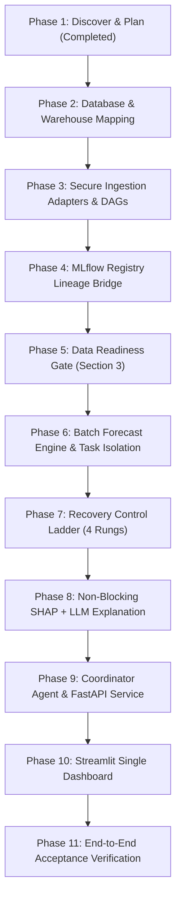

# Demand Agent: Component Mapping, Gap Analysis & Master Implementation Plan

This document maps the 7-layer Demand Agent architecture and product requirements against the existing codebase across all repository branches, identifies implementation gaps, and establishes the phase-by-phase execution plan.

---

## 1. Architectural Component Mapping Table

| Architecture Component | Required Specification | Existing Codebase Implementation | Status | Reusability & Action Plan |
|---|---|---|:---:|---|
| **Layer 1: External Data Sources** | Open-Meteo (history + forecasts), Calendarific (holidays/festivals), Historical demand import | `check_all.py` (live API verification), `demand_agent_ingestion/src/demand_ingestion/calendarific_client.py` (on feature branch), `Datasets/raw/` (Excel historical files) | **Partial** | Reuse live API adapter logic from `check_all.py` and `calendarific_client.py`; standardize into robust, productionized adapters with timeout/backoff. |
| **Layer 2: Secure Ingestion & Hygiene** | Airflow DAGs (weather + festival), schema/freshness validation, quarantine queue, safe idempotent upsert | `demand_agent_ingestion/dags/weather_ingestion_dag.py`, `festival_ingestion_dag.py`, `demand_agent_ingestion/src/demand_ingestion/database/upsert_manager.py` (on feature branch) | **Partial** | Port and adapt Airflow DAGs and idempotent upsert manager to current project layout; verify quarantine logic with live and fixture tests. |
| **Layer 3: MongoDB Persistent State** | Authenticated least-privilege store: 6 logical collections (demand, weather, festivals, mappings, results, run metadata), unique indexes, warehouse key | `demand_agent/config.py`, `demand_agent/db.py`, MongoDB database `demand_agent` with 42 collections (30k historical demand docs, 150 weather docs, 200 products, etc.) | **Complete / Needs Index Audit** | Connection and data are established and validated (10/10 collection checks passed). Audit and ensure unique indexes and warehouse-to-region mapping (`WH-001` $\leftrightarrow$ `KOL-LOC-001`). |
| **Layer 4: Offline Training Pipeline** | Ridge regression main model, 34 features, temporal leakage tests, rolling backtest, Gate Rule C, MLflow model registry, Global LightGBM standby | `demand_agent/features.py`, `demand_agent/training/ridge_trainer.py`, `demand_agent/training/train_all.py`, `demand_agent/training/gate.py`, `demand_agent/training/registry.py`, `demand_agent/training/lgbm_trainer.py`, `artifacts/models/` (200 Ridge + 1 Global LightGBM) | **Complete / Needs MLflow Bridge** | Core training, 200 Ridge models, Gate Rule C, MongoDB model registry, and Global LightGBM standby are fully built and verified. Bridge model artifacts to MLflow registry format. |
| **Layer 5: Weekly Forecast Execution** | FastAPI authentication + validation, target week resolution, task generator, 52-wk lookback fetcher, merger, batch prediction, task isolation | `demand_agent/forecast/week_resolver.py`, `task_generator.py`, `data_fetcher.py`, `merger.py`, `demand_agent/scripts/run_step_5_1.py`, `run_step_5_2.py`, `demand_agent_forecast/api.py` (feature branch) | **Partial** | Steps 5.1 and 5.2 are verified. Connect the assembled task frames to model prediction, validate outputs, enforce task failure isolation, and save to `forecast_results`. |
| **Layer 6: Recovery Control** | Fallback ladder: Champion Ridge $\rightarrow$ Standby LightGBM $\rightarrow$ Seasonal/Rolling Baseline $\rightarrow$ "No Safe Forecast Available", explicit failure logging | `demand_agent/training/registry.py` (`FALLBACK_CHAIN`), `demand_agent/training/lgbm_trainer.py` (32 rescued products), `demand_agent_forecast/engine.py` (feature branch fallback hooks) | **Partial** | Unify the recovery ladder into the forecast execution pipeline; assign explicit `method` tag (`champion`, `fallback_model`, `baseline`) and explicit error statuses. |
| **Layer 7: Non-Blocking Explanation** | Exact linear SHAP feature attribution for Ridge, LLM narrative (Gemini), circuit breaker fallback to deterministic template | `check_all.py` (Gemini API check), initial SHAP scripts | **Missing** | Build linear SHAP calculator ($\phi_i = w_i \cdot (x_i - \mu_i)$), prompt synthesizer for Gemini with read-only context, and circuit breaker with timeout/error fallback template. |
| **Section 3: Data Readiness Gate** | Pre-forecast gate per warehouse: check demand lookback, weather history/forecast, festival calendar, product mappings, approved model; HTTP 409 JSON + human message | Conceptualized; partial checks in `task_generator.py` and `data_fetcher.py` | **Missing / High Priority** | Implement dedicated `readiness_gate.py` with structured output (`ready: bool`, `issues: [...]`) and test suite verifying all 5 failure modes. |
| **Section 5: Single Coordinator Agent** | Single coordinator agent class owning the entire flow with 5 tools: readiness, forecast, explanation, status, summary; audit logging | Architectural blueprint; previously fragmented between CLI scripts | **Missing** | Implement unified `DemandCoordinatorAgent` class in `demand_agent/agent/coordinator.py` exposing the 5 tools and enforcing the readiness invariant. |
| **FastAPI REST Service** | Authenticated endpoints: `/health`, `/readiness`, `/forecast/run`, `/forecast/runs/{run_id}`, `/forecast/results`, `/forecast/explain/{id}` | Earlier implementation in `demand_agent_forecast/api.py` (feature branch) | **Partial** | Port and modernize FastAPI app into `demand_agent/api/app.py`, wrapping the coordinator agent with API-key and Bearer token auth, Pydantic schemas, and audit logs. |
| **Section 6: Single Dashboard** | Single-page Streamlit application with 6 ordered sections: Header controls, Readiness panel, Forecast view, Explanation panel, Run history, Model health | None in workspace (Streamlit was missing) | **Missing** | Implement `dashboard/app.py` in Streamlit with real-time reactive panels, interactive Plotly charts, paginated tables, and zero raw stack traces. |

---

## 2. Gap Analysis by Functional Area

### Gap 1: Ingestion & Hygiene Subsystem (Layer 1 & 2)
* **What exists:** Verified Open-Meteo and Calendarific API connectivity in `check_all.py`; earlier Airflow DAG scripts in `demand_agent_ingestion/dags/`.
* **What is missing:** Integrated production adapters in `demand_agent/ingestion/` with standardized retry/backoff, schema validation against strict limits, a functional quarantine handler, and a one-time historical demand validation report script.

### Gap 2: Warehouse as a First-Class Entity (Layer 3)
* **What exists:** `region_id: KOL-LOC-001` is embedded across all collections. In the raw master tables, `WH-001` maps to `KOL-LOC-001`.
* **What is missing:** An explicit warehouse resolver/mapping helper so the user can query by `WH-001` or `KOL-LOC-001` interchangeably, and so the Readiness Gate can explicitly report unpopulated warehouses (`WH-002` through `WH-015`) as NOT READY.

### Gap 3: MLflow Registry Lineage Bridge (Layer 4)
* **What exists:** 200 Ridge models + 1 Global LightGBM standby model trained and evaluated; metadata and SHA256 hashes recorded in MongoDB `model_registry`.
* **What is missing:** An automated MLflow registration script logging artifacts, parameters, metrics, and tags to `mlruns` / `sqlite:///./mlruns.db` for full governance.

### Gap 4: End-to-End Batch Forecasting Engine (Layer 5 & 6)
* **What exists:** `week_resolver.py`, `task_generator.py`, `data_fetcher.py`, `merger.py` (verified in `run_step_5_1.py` and `run_step_5_2.py`).
* **What is missing:** The complete prediction and fallback pipeline: loading the champion Ridge model from the registry, predicting, falling back to LightGBM standby if Ridge is not approved or fails, falling back to rolling baseline if LightGBM fails, and recording explicit `"No Safe Forecast Available"` if baseline is exhausted.

### Gap 5: Data Readiness Gate (Section 3 - Core Requirement)
* **What exists:** Partial lookback checks inside `task_generator.py`.
* **What is missing:** The formal, comprehensive pre-flight gate that independently verifies demand lookback, weather history, weather forecast horizon, festival freshness, active product mappings, and model compatibility before any merge or feature building takes place.

### Gap 6: Non-Blocking Explanation Layer (Layer 7)
* **What exists:** Working Gemini API key and verified `gemini-3.5-flash` endpoint in `check_all.py`.
* **What is missing:** Closed-form linear SHAP calculator for Ridge regression, prompt template enforcing citations restricted strictly to top SHAP features, and an asynchronous circuit breaker returning deterministic template explanations upon LLM error or timeout.

### Gap 7: Coordinator Agent & Single Dashboard (Section 5 & 6)
* **What exists:** Individual CLI scripts (`run_step_4_2.py`, `run_step_4_4.py`, `run_step_5_2.py`).
* **What is missing:**
  1. The unified `DemandCoordinatorAgent` presenting the 5 required tools.
  2. The unified FastAPI REST API.
  3. The single-page Streamlit dashboard implementing the 6 prescribed visual sections.

---

## 3. Phase-by-Phase Master Implementation Plan

### Detailed Execution Roadmap

1. **Phase 1: Codebase Discovery & Planning (Current Phase)**
   - Audit repository, commits, and database.
   - Produce `assumptions.md` and `component_mapping_and_gap_analysis.md`.

2. **Phase 2: Database Audit & Warehouse Entity Normalization**
   - Create warehouse mapping utility (`WH-001` $\leftrightarrow$ `KOL-LOC-001`).
   - Audit unique indexes in MongoDB to guarantee idempotency across `forecast_results`, `run_metadata`, `weather_history`, and `festival_calendar`.
   - Run historical demand validation report script.

3. **Phase 3: Secure Ingestion Adapters, Validation & Quarantine**
   - Implement production-grade Open-Meteo and Calendarific API adapters with timeouts, exponential backoff, and quarantine queues.
   - Port and configure Airflow DAGs for scheduled execution.
   - Test with recorded API fixtures and live connectivity checks.

4. **Phase 4: MLflow Lineage & Model Registry Bridge**
   - Install `mlflow`.
   - Register the 200 Ridge models, Gate Rule C evaluation metrics, and Global LightGBM standby model in MLflow registry with parameters and schema tags.
   - Retain MongoDB `model_registry` as the runtime operational champion store.

5. **Phase 5: Data Readiness Gate (Critical Requirement)**
   - Implement `demand_agent/readiness/gate.py`.
   - Check: (1) Historical demand lookback (52 weeks, no missing periods), (2) Weather history coverage, (3) Weather forecast coverage (target week), (4) Festival calendar freshness, (5) Active product mappings, (6) Approved model presence.
   - Return structured HTTP 409-style JSON + human-readable message.
   - Build unit test suite asserting all negative scenarios and the positive loaded scenario.

6. **Phase 6: Weekly Forecast Batch Pipeline & Task Isolation**
   - Implement `WeeklyBatchForecastEngine` executing tasks concurrently via `ThreadPoolExecutor(max_workers=4)`.
   - Invariant: A failure in product task $k$ records an isolated error in `run_metadata` and allows all other tasks to finish.
   - Persist valid forecasts to `forecast_results` using idempotent upserts.

7. **Phase 7: Multi-Tier Recovery Ladder**
   - Build fallback runner implementing the 4-rung hierarchy:
     - Rung 1: Champion Ridge model.
     - Rung 2: Standby Global LightGBM model.
     - Rung 3: Validated rolling median / seasonal naive baseline.
     - Rung 4: Explicit `"No Safe Forecast Available"` error record.
   - Unit tests for every rung forcing failures down the ladder.

8. **Phase 8: Non-Blocking Explanation Layer**
   - Exact linear SHAP feature contributions for Ridge models:
     $$\phi_i = w_i \cdot \frac{x_i - \mu_i}{\sigma_i}$$
     Verifying $\sum \phi_i + \text{intercept} = \hat{y}_{\text{log}}$.
   - Gemini LLM narrative generator restricted to top SHAP drivers.
   - Circuit breaker: timeout ($>10\text{s}$) or API failure triggers deterministic template fallback without delaying forecast delivery.

9. **Phase 9: Single Coordinator Agent & FastAPI Service**
   - Implement `DemandCoordinatorAgent` exposing the 5 canonical tools.
   - Implement FastAPI application with API key authentication, request validation, and OpenAPI documentation.
   - Unit tests covering all 5 coordinator tools.

10. **Phase 10: Single Streamlit Dashboard**
    - Install `streamlit`.
    - Build `dashboard/app.py` implementing the 6 prescribed sections:
      1. Header controls (Warehouse, Product, Region, Target Week, Action Buttons)
      2. Data readiness panel (green/amber/red indicators with exact missing item lists)
      3. Forecast view (interactive historical + forecast + interval charts, summary table)
      4. Explanation panel (SHAP bar chart + narrative explanation + status)
      5. Run history and errors (auditable run table, quarantine counters, failure reasons)
      6. Model health (active champions, backtest WAPE, gate results)
    - Zero raw stack traces; robust loading, empty, and error states.

11. **Phase 11: End-to-End Acceptance Verification & Final Deliverables**
    - Execute the 13-item acceptance checklist with concrete command runs and evidence.
    - Produce final report: built vs changed, run instructions, checklist results, limitations, and future improvements.

---

## 4. Risk Assessment & Mitigations

| Risk | Severity | Probability | Mitigation Strategy |
|---|:---:|:---:|---|
| **Lookback Gaps on New / Inactive Products** | High | Medium | Task generator filters products with $< 52$ completed weeks into explicit "Ineligible" status; Recovery ladder catches unexpected history gaps and routes to baseline. |
| **LLM Latency / Rate Limits During Explanation** | Medium | High | Decouple explanation into asynchronous non-blocking tier with circuit breaker and deterministic template fallback. |
| **Idempotency Failure on Multiple Re-Runs** | High | Low | Enforce unique composite indexes in MongoDB (`(region_id, product_id, target_week)` on `forecast_results` and `(run_id)` on `run_metadata`). |
| **Dependency Conflicts with Airflow / MLflow** | Medium | Medium | Install required packages cleanly into `.venv` with pinned compatible versions; document exact environment in `requirements.txt`. |
| **Unpopulated Warehouses Selected in Dashboard** | Medium | High | Data Readiness Gate proactively intercepts unpopulated warehouse selections (`WH-002` to `WH-015`) and displays exact missing datasets before forecast execution is permitted. |
